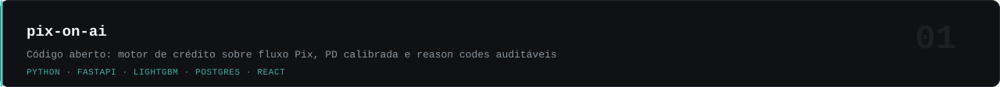
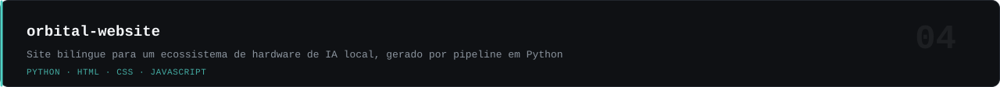
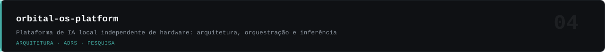
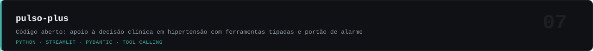
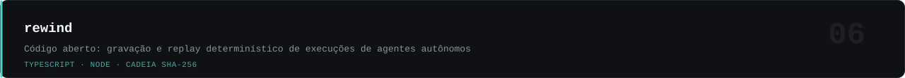
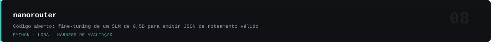
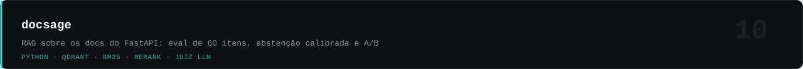
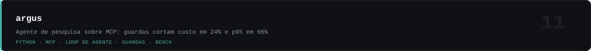

**[English](README.md)**

A maior parte dos produtos que desenvolvo e coloco em produção é privada. O que compartilho aqui é a engenharia por trás deles: como os sistemas são arquitetados, quais decisões técnicas foram determinantes, os trade-offs envolvidos e os desafios encontrados ao transformar ideias em produtos reais.

Os repositórios abaixo apresentam estudos de caso de projetos efetivamente desenvolvidos, com uma abordagem técnica voltada a engenheiros e profissionais de tecnologia, não a apresentações comerciais. A maioria não é open source e nenhum deles expõe código proprietário ou dados de clientes; os que são abertos estão identificados como tal.


<a href="https://github.com/yahbeaumont/pix-on-ai"></a>
<a href="https://github.com/yahbeaumont/zoka-platform"></a>

<a href="https://github.com/yahbeaumont/vai-de-qual"></a>

<a href="https://github.com/yahbeaumont/orbital-website"></a>

<a href="https://github.com/yahbeaumont/orbital-os-platform"></a>

<a href="https://github.com/yahbeaumont/jer-crm"></a>

<a href="https://github.com/yahbeaumont/pulso-plus"></a>

<a href="https://github.com/yahbeaumont/rewind"></a>

<a href="https://github.com/yahbeaumont/nanorouter"></a>

<a href="https://github.com/yahbeaumont/docsage"></a>

<a href="https://github.com/yahbeaumont/argus"></a>


Começo pelas restrições, não pelo framework. Requisitos regulatórios, tamanho da equipe, prioridades do negócio e prazos de entrega influenciam muito mais a arquitetura de um sistema do que preferências pessoais por uma biblioteca ou tecnologia específica.

Estabeleço fronteiras claras para dinheiro e identidade. O navegador nunca deve ser considerado confiável para autorizar operações financeiras, acessar dados de outros usuários ou modificar permissões. Sempre que uma regra puder ser imposta diretamente pelo banco de dados, ela deve ser.

Documento as decisões e suas razões. Registrar por que um sistema foi concebido de determinada maneira custa muito menos do que reconstruir esse raciocínio no futuro, especialmente quando quem precisa fazer isso sou eu, dois anos depois.

Prefiro infraestrutura previsível e ciclos curtos de feedback. Menos componentes desnecessários, estado observável, processos claros e mecanismos de rollback que realmente funcionam. Confiabilidade é resultado de decisões de engenharia deliberadas, não de complexidade desnecessária.


```text
linguagens   typescript · python · node.js
frameworks   nestjs · next.js · react
dados        postgresql · redis · firebase · cloud run
pagamentos   stripe · pix
ia           integração de llm · modelos de peso aberto
             inferência local em hardware real
```


Os estudos de caso estão disponíveis em **inglês** e **português brasileiro**. Cada repositório especifica seu escopo, seus limites e quais informações e materiais foram intencionalmente excluídos da publicação. Os repositórios pix-on-ai, rewind, nanorouter, docsage e argus são a exceção: os cinco são código aberto, sob licença MIT, e trazem o código em vez de um estudo de caso.
