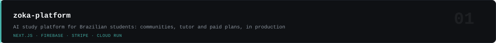
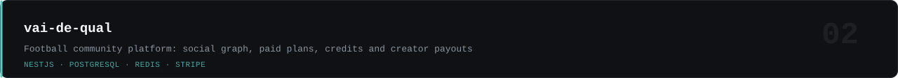
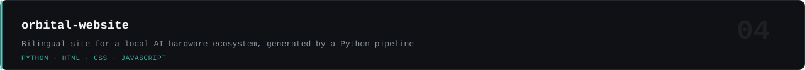
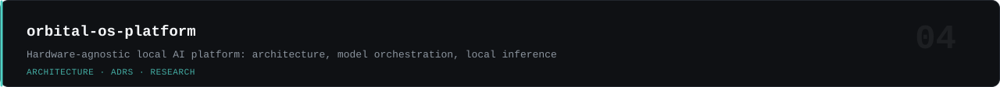
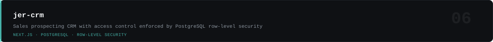
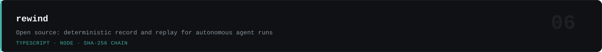

**[Português](PORTUGUES.md)**

Most of the products I build are private by design. What I share here is the engineering behind them: how systems are architected, the technical decisions that shape them, the trade-offs involved, and the challenges of taking products from concept to production.


<a href="https://github.com/yahbeaumont/zoka-platform"></a>

<a href="https://github.com/yahbeaumont/vai-de-qual"></a>

<a href="https://github.com/yahbeaumont/orbital-website"></a>

<a href="https://github.com/yahbeaumont/orbital-os-platform"></a>

<a href="https://github.com/yahbeaumont/jer-crm"></a>

<a href="https://github.com/yahbeaumont/rewind"></a>


I start with constraints, not frameworks. Regulatory requirements, team size, business priorities, and delivery timelines shape a system far more than personal preferences for a particular library or technology.

I draw clear boundaries around money and identity. The browser is never trusted to authorize financial operations, expose another user's data, or change access privileges. Whenever a rule can be enforced at the database level, it should be.

I document the reasoning behind decisions. Understanding why a system was designed a certain way is far less expensive than reconstructing that reasoning later, especially when the person doing it is me, two years down the road.

I favor boring infrastructure and short feedback loops. Fewer moving parts, observable system behavior, explicit state, and rollback mechanisms that actually work. Reliability comes from deliberate engineering, not unnecessary complexity.


```text
languages   typescript · python · node.js
frameworks  nestjs · next.js · react
data        postgresql · redis · firebase · cloud run
payments    stripe · pix
ai          llm integration · open-weight models
            local inference on tested hardware
```


Case studies are available in English and Brazilian Portuguese. Each repository clearly defines its scope, technical boundaries, and what has intentionally been excluded. The rewind repository is the exception: it is open source, MIT licensed, and carries the code rather than a case study.
