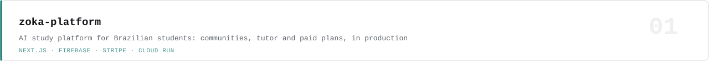
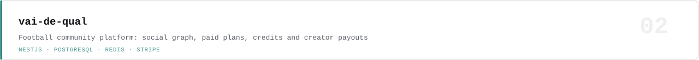
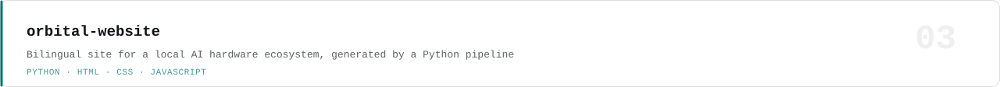
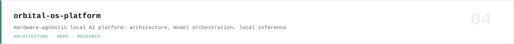
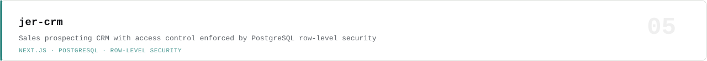

<picture>
  <source media="(prefers-color-scheme: dark)" srcset="assets/hero-dark.svg">
  
</picture>

**[Português](PORTUGUES.md)**

Most of the products I build are private by design. What I share here is the engineering behind them: how systems are architected, the technical decisions that shape them, the trade-offs involved, and the challenges of taking products from concept to production.

<picture>
  <source media="(prefers-color-scheme: dark)" srcset="assets/sec-01-dark.svg">
  
</picture>

<a href="https://github.com/yahbeaumont/zoka-platform"><picture>
  <source media="(prefers-color-scheme: dark)" srcset="assets/zoka-platform-dark.svg">
  
</picture></a>

<a href="https://github.com/yahbeaumont/vai-de-qual"><picture>
  <source media="(prefers-color-scheme: dark)" srcset="assets/vai-de-qual-dark.svg">
  
</picture></a>

<a href="https://github.com/yahbeaumont/orbital-website"><picture>
  <source media="(prefers-color-scheme: dark)" srcset="assets/orbital-website-dark.svg">
  
</picture></a>

<a href="https://github.com/yahbeaumont/orbital-os-platform"><picture>
  <source media="(prefers-color-scheme: dark)" srcset="assets/orbital-os-platform-dark.svg">
  
</picture></a>

<a href="https://github.com/yahbeaumont/jer-crm"><picture>
  <source media="(prefers-color-scheme: dark)" srcset="assets/jer-crm-dark.svg">
  
</picture></a>

<picture>
  <source media="(prefers-color-scheme: dark)" srcset="assets/sec-02-dark.svg">
  
</picture>

I start with constraints, not frameworks. Regulatory requirements, team size, business priorities, and delivery timelines shape a system far more than personal preferences for a particular library or technology.

I draw clear boundaries around money and identity. The browser is never trusted to authorize financial operations, expose another user's data, or change access privileges. Whenever a rule can be enforced at the database level, it should be.

I document the reasoning behind decisions. Understanding why a system was designed a certain way is far less expensive than reconstructing that reasoning later, especially when the person doing it is me, two years down the road.

I favor boring infrastructure and short feedback loops. Fewer moving parts, observable system behavior, explicit state, and rollback mechanisms that actually work. Reliability comes from deliberate engineering, not unnecessary complexity.

<picture>
  <source media="(prefers-color-scheme: dark)" srcset="assets/sec-03-dark.svg">
  
</picture>

```text
languages   typescript · python · node.js
frameworks  nestjs · next.js · react
data        postgresql · redis · firebase · cloud run
payments    stripe · pix
ai          llm integration · open-weight models · local inference on tested hardware
```

<picture>
  <source media="(prefers-color-scheme: dark)" srcset="assets/sec-04-dark.svg">
  
</picture>

Case studies are available in English and Brazilian Portuguese. Each repository clearly defines its scope, technical boundaries, and what has intentionally been excluded.
